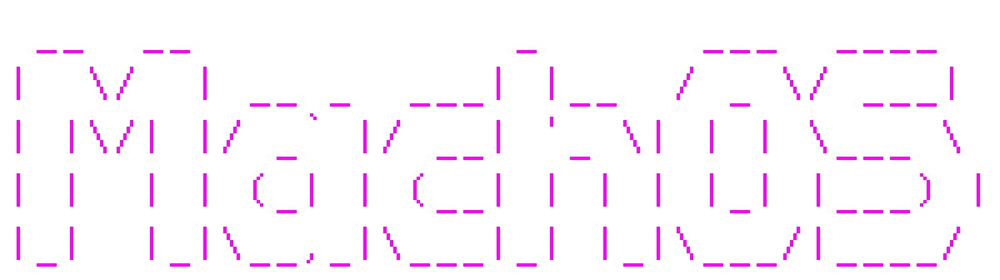

<p align="center">
  
</p>

<p align="center">
  <a href="https://github.com/Wmakes/MachOS/releases/latest"></a>
  
  <a href="https://machlang.org/"></a>
  
  <a href="LICENSE"></a>
  
</p>

A small Unix-like operating system for x86_64, written in [mach](https://machlang.org/): the kernel, the boot loader and the userland.

## What it has

- **Kernel**: every CPU core (SMP), preemptive multitasking, processes and threads (futexes), signals, pipes, `mmap`, readiness queues, `/proc`, `/dev/events`
- **Boot**: `machboot`, its own UEFI boot loader (also written in mach), dual boot with Windows, a live ISO that runs from memory and can install itself
- **Storage**: AHCI and NVMe disks, GPT, ext2 (the root), FAT32 and exFAT (USB sticks, the EFI partition), `fsck`
- **Devices**: xHCI USB with hubs and hotplug, PS/2 and USB keyboards, framebuffer and serial consoles, RTC with time zones
- **Userland**: over eighty programs, most of them on [MachOS's standard library](https://github.com/Wmakes/machos-std): a shell with job control and line editing, `nano`, `less`, `tar`, `gzip`, `grep`, `sort`, `top`, and our own package manager called `mpm`. `ls /bin` lists the programs
## Try it

You don't need to build MachOS from source to try it out! Prebuilt ISO images are available on the project's GitHub Releases page.

Download the latest `machos-*.*.*.iso` from the [Releases page](../../releases/latest).

MachOS supports UEFI booting and can run in a virtual machine or directly on compatible x86_64 hardware.

### QEMU (Recommended)

The easiest and safest way to try MachOS is through QEMU, without modifying your existing operating system or disks.

You'll need QEMU and OVMF (UEFI firmware) installed.

Boot the downloaded ISO:

```bash
qemu-system-x86_64 \
  -M q35 \
  -cpu max \
  -m 2G \
  -smp 2 \
  -cdrom machos-*.*.*.iso \
  -boot d \
  -drive if=pflash,format=raw,readonly=on,file=/usr/share/edk2/x64/OVMF_CODE.4m.fd
```
(Replace *.*.* with the actual version in the iso name.)
The OVMF firmware path may differ depending on your operating system or distribution.

Once MachOS boots, log in as `root`.

You can explore the system directly from the live environment without installing it.

### Real Hardware (Bare Metal)

MachOS can also boot directly on a physical x86_64 computer using a USB drive.

**Requirements:**
- A 64-bit x86_64 computer with UEFI firmware
- A USB drive
- The downloaded `machos-*.*.*.iso`
- Secure Boot disabled

**Option 1: Ventoy**

1. Install [Ventoy](https://www.ventoy.net/) on your USB drive.
2. Copy `machos-*.*.*.iso` onto the Ventoy drive.
3. Reboot your computer and open its boot menu.
4. Select the USB drive and boot MachOS.

**Option 2: Write the ISO directly (Linux)**

Identify your USB drive:

```bash
lsblk
```

Then write the ISO to it:

```bash
sudo dd if=machos-*.*.*.iso of=/dev/sdX bs=4M status=progress conv=fsync
```
(Replace *.*.* with the actual version in the .iso filename and replace `/dev/sdX` with your actual USB device, not a partition.) 
**Warning:** This command will erase all data on the selected USB drive. Double-check the device before running it.

**Option 3: Rufus or balenaEtcher (Windows)**

On Windows, you can use a graphical utility to create a bootable USB drive.

1. Download and install [Rufus](https://rufus.ie/) or [balenaEtcher](https://etcher.balena.io/).
2. Insert your USB drive.
3. Select the downloaded `machos-*.*.*.iso`.
4. Select your USB drive as the target.
5. Write the image to the drive. If Rufus offers a choice between ISO and DD modes, use DD mode.
6. Reboot and select the USB drive from your UEFI boot menu.

**Warning:** Writing the image will erase the contents of the selected USB drive.

### Booting and Installing

Once MachOS boots, log in as `root`.

MachOS runs as a live system, so installation is not required.

To install MachOS permanently, run:

```bash
install
```

**Warning:** Installing an operating system can overwrite existing partitions or data. Back up important files before attempting installation.
## Building

### Prerequisites

You need the [Mach compiler](https://github.com/briar-systems/mach) (version **6.10**) and several system utilities to build disk images, generate ISOs, and run the OS in QEMU.

### Linux

**Arch Linux / Manjaro / EndeavourOS**

```bash
sudo pacman -S lld gptfdisk e2fsprogs mtools xorriso qemu-system-x86 edk2-ovmf python
```

**Debian / Ubuntu / Linux Mint**

```bash
sudo apt install lld gdisk e2fsprogs mtools xorriso qemu-system-x86 ovmf python3
```

**Fedora**

```bash
sudo dnf install lld gdisk e2fsprogs mtools xorriso qemu-system-x86 edk2-ovmf python3
```

**openSUSE Tumbleweed / Leap**

```bash
sudo zypper install lld gptfdisk e2fsprogs mtools xorriso qemu-x86 ovmf python3
```

**Alpine Linux**

```bash
sudo apk add lld gptfdisk e2fsprogs mtools xorriso qemu-system-x86_64 ovmf python3 bash
```

Package names and availability may vary depending on your distribution and version. Some systems may require additional repositories or packages.


**WSL2 is the recommended approach for Windows users.** Install a Linux distribution under WSL2 and follow its corresponding Linux installation instructions above. (or you can switch to Linux full-time which is better anyway :))

So far, I have only built and tested MachOS on Arch Linux. Other Linux distributions should work with the dependencies listed above, but they have not been verified. Building under WSL2 is also untested.


### Testing and Running

Once the dependencies and Mach compiler are installed, run the following commands from the repository root:

```bash
tools/run.sh              # Build a disk image and boot it in QEMU
tools/run.sh release      # Build and boot an optimized release
tools/run.sh --fresh      # Start with a fresh disk image
tools/iso.sh              # Build the live ISO (out/machos.iso)
tools/test.py             # Run all tests
tools/test.py wget tcp    # Run only the specified tests
```

`tools/test.py` boots MachOS in QEMU and drives it over the serial console: boot, shell, USB, boot loader menus, dual boot, install, update, filesystems, `fsck` and rescue, the network (a host-side UDP echo and web server stand in for the internet), and std's own test suite. Tests that need the internet, such as `dns`, say so in the test table.

## Debugging

```
tools/gdb.sh                    # boot paused, with a gdb stub on :1234
tools/mount.sh                  # mount the dev disk on the host, without sudo
tools/put.sh FILE               # copy a file onto the disk image
tools/boot.sh IMAGE|/dev/sdX    # boot an existing install as it is
```

## Layout

| Directory | What is in it |
|-----------|---------------|
| `kernel/` | the kernel: architecture-specific code (`arch`), memory management (`mm`), processes and system calls (`kern`), filesystems (`fs`), devices (`dev`), networking (`net`), ACPI, boot code and tests |
| `machboot/` | the UEFI boot loader |
| `sdk/` | MachOS's system-call layer and runtime for programs that need direct access to OS functionality |
| `userland/` | programs (`src/bin`), shared libraries (`src/lib`), and dedicated components such as the shell, editor and package manager; `mach.toml` is partly generated by `tools/programs.sh` |
| `root/` | files copied onto the root filesystem, including `/etc`, `/boot`, `/bin` and `/usr` |
| `examples/` | `hello`, `posixtest`, `stdtest` and `tlstest` |
| `deps/` | dependencies including [machos-std](https://github.com/Wmakes/machos-std), [mach-crypto](https://github.com/briar-systems/mach-crypto), [mach-http](https://github.com/briar-systems/mach-http), [mach-pki](https://github.com/briar-systems/mach-pki) and [mach-tls](https://github.com/briar-systems/mach-tls) |
| `packages/` | package definitions and metadata for `mpm` |
| `tools/` | build, boot, testing, disk-image, dependency and package-management scripts |

## Status

MachOS is a hobby operating system and is still under development. Bugs, crashes, data loss, hardware incompatibilities, and unexpected behavior are possible.

**MachOS is provided "AS IS", without any warranty, express or implied.** There is no guarantee of stability, reliability, fitness for a particular purpose, or compatibility with your hardware (I mean, we have three Ethernet drivers, two are for virtual machines, and the third is for the Ethernet card in my PC).

Always back up important data before installing MachOS on physical hardware. Testing in a virtual machine is strongly recommended.

Batteries not included.

## License

MachOS is licensed under GNU General Public License, version 3 only. Third-party components retain their respective licences.

